# KIẾN TRÚC HỆ THỐNG QUẢN LÝ SINH VIÊN VÀ KHÓA HỌC (J1.L.P0039)

Tài liệu này tổng hợp chi tiết cấu trúc các package, class, thuộc tính (attributes), phương thức (methods), sơ đồ quan hệ (Class Diagram) và **trừu tượng hóa luồng thực thi (Execution Flow)** của từng chức năng trong hệ thống, phục vụ trực tiếp cho việc hiện thực mã nguồn.

---

## 1. SƠ ĐỒ LỚP TỔNG QUAN (MERMAID CLASS DIAGRAM)

```mermaid
classDiagram
    direction TB

    %% ================= MODEL =================
    namespace Model {
        class Student {
            -String studentId
            -String fullName
            -String major
            -double gpa
            +Student()
            +Student(String, String, String, double)
            +getStudentId() String
            +getFullName() String
            +setFullName(String) void
            +getMajor() String
            +setMajor(String) void
            +getGpa() double
            +setGpa(double) void
            +toScreen() String
            +toString() String
        }

        class Course {
            -String courseId
            -String studentId
            -String name
            -int duration
            -LocalDate startDate
            +Course()
            +Course(String, String, String, int, LocalDate)
            +getCourseId() String
            +getStudentId() String
            +setStudentId(String) void
            +getName() String
            +setName(String) void
            +getDuration() int
            +setDuration(int) void
            +getStartDate() LocalDate
            +setStartDate(LocalDate) void
            +toScreen() String
            +toString() String
        }
    }

    %% ================= UTILS =================
    namespace utils {
        class FileHelper~T~ {
            <<abstract>>
            -ArrayList~T~ dataList
            +FileHelper(ArrayList~T~)
            +loadFromFile(String) boolean
            +saveToFile(String) boolean
            +handleLine(String)* T
        }

        class Inputter {
            +Scanner scanner
            +DATE_PATTERN: String
            +stuIdRegex: String
            +courseIdRegex: String
            +NAME_PATTERN: String
            +Inputter(Scanner)
            +getAnInteger(String, String) int
            +getAnInteger(String, String, int, int) int
            +getADouble(String, String) double
            +getADouble(String, String, double, double) double
            +getAString(String, String) String
            +getAString(String, String, String) String
            +getYesNo(String) boolean
            +getDate(String, String) LocalDate
        }

        class Menu~T~ {
            -Inputter inputter
            -String title
            -ArrayList~String~ optionList
            +Menu(String, Inputter)
            +addNewOption(String) void
            +show() void
            +getChoice() int
            +ref_getChoice(ArrayList~T~) T
        }
    }

    %% ================= REPOSITORY =================
    namespace Repository {
        class StudentRepository {
            -ArrayList~Student~ stuList
            -FileHelper~Student~ fhStudent
            +StudentRepository()
            +add(Student) boolean
            +updateGpa(String, double) boolean
            +remove(String) boolean
            +getAll() ArrayList~Student~
            +loadFromFile(String) boolean
            +saveToFile(String) boolean
        }

        class CourseRepository {
            -ArrayList~Course~ courseList
            -FileHelper~Course~ fhCourse
            +CourseRepository()
            +add(Course) boolean
            +getAll() ArrayList~Course~
            +loadFromFile(String) boolean
            +saveToFile(String) boolean
        }
    }

    StudentRepository *-- FileHelper : uses
    CourseRepository *-- FileHelper : uses

    %% ================= SERVICES =================
    namespace Services {
        class DeleteStudentResult {
            <<enumeration>>
            SUCCESS
            NOT_FOUND
            HAS_COURSES
        }

        class StudentService {
            -StudentRepository studentRepo
            -CourseRepository courseRepo
            -boolean isChanged
            +StudentService(StudentRepository, CourseRepository)
            +isChanged() boolean
            +setSaved() void
            +addStudent(Student) boolean
            +updateStudentGpa(String, double) boolean
            +searchStudent(String) Student
            +getAllStudents() ArrayList~Student~
            +getStudentsByMajor(String) ArrayList~Student~
            +getStudentsSortedByGpaAsc() ArrayList~Student~
            +removeStudent(String) DeleteStudentResult
            +checkExist(String) boolean
            +loadData(String) boolean
            +saveData(String) boolean
        }

        class CourseService {
            -CourseRepository courseRepo
            -StudentRepository studentRepo
            -boolean isChanged
            +CourseService(CourseRepository, StudentRepository)
            +isChanged() boolean
            +setSaved() void
            +addCourse(Course) boolean
            +getAllCourses() ArrayList~Course~
            +checkExist(String) boolean
            +hasCoursesOfStudent(String) boolean
            +getCoursesByStudentId(String) ArrayList~Course~
            +getCoursesGroupedByStudent() Map~String, List~Course~~
            +calculateTotalDuration(String) int
            +loadData(String) boolean
            +saveData(String) boolean
        }
    }

    StudentService --> StudentRepository : uses
    StudentService --> CourseRepository : uses
    StudentService ..> DeleteStudentResult : returns
    CourseService --> CourseRepository : uses
    CourseService --> StudentRepository : uses

    %% ================= CONTROLLER =================
    namespace Controller {
        class StudentController {
            -StudentService studentService
            -Inputter inputter
            -String STUDENTS_FILE: "Students.txt"
            +StudentController(StudentService, Inputter)
            +listAllStudents() void
            +addStudent() void
            +searchStudent() void
            +updateStudentGpa() void
            +listStudentsByMajor() void
            +removeStudent() void
            +sortStudentsByGpa() void
            +loadData(String) boolean
            +saveData(String) boolean
            +hasUnsavedChanges() boolean
            +markSaved() void
        }

        class CourseController {
            -CourseService courseService
            -StudentService studentService
            -Inputter inputter
            -Menu~Student~ studentMenu
            -String COURSES_FILE: "Courses.txt"
            +CourseController(CourseService, StudentService, Inputter)
            +addCourse() void
            +listCoursesGroupedByStudent() void
            +calculateStudyDuration() void
            +loadData(String) boolean
            +saveData(String) boolean
            +hasUnsavedChanges() boolean
            +markSaved() void
        }

        class MainView {
            -StudentController studentController
            -CourseController courseController
            -Inputter inputter
            -Menu~String~ mainMenu
            -String STUDENTS_FILE: "Students.txt"
            -String COURSES_FILE: "Courses.txt"
            +MainView(StudentController, CourseController, Inputter)
            +run() void
            -viewMenu() void
            -saveAllFiles() boolean
            -handleQuit() boolean
            -hasUnsavedChanges() boolean
        }
    }

    StudentController --> StudentService : uses
    StudentController --> Inputter : uses
    CourseController --> CourseService : uses
    CourseController --> StudentService : uses
    CourseController --> Inputter : uses
    CourseController --> Menu : uses
    MainView --> StudentController : delegates
    MainView --> CourseController : delegates
    MainView --> Inputter : uses
    MainView --> Menu : displays

    %% ================= RUNTIME =================
    namespace runtime {
        class Program {
            +main(String[]) void$
        }
    }

    Program ..> MainView : bootstraps
```



---

## 2. CHI TIẾT TỪNG PACKAGE VÀ CLASS

### Package `Model`
* **`Student.java`**:
  * Fields: `studentId: String`, `fullName: String`, `major: String`, `gpa: double`.
  * `toString()`: Trả về chuỗi lưu file `Students.txt` (`STU0001, Nguyen Van An, Software Engineering, 3.4`).
  * `toScreen()`: Trả về chuỗi format dạng cột cho console (`%-10s | %-25s | %-25s | %5.2f`).
* **`Course.java`**:
  * Fields: `courseId: String`, `studentId: String`, `name: String`, `duration: int`, `startDate: LocalDate`.
  * `toString()`: Trả về chuỗi lưu file `Courses.txt` (`CSE201, STU0002, Database Systems, 10, 15/09/2025`).
  * `toScreen()`: Trả về chuỗi format hiển thị console (`%-10s | %-30s | %2d weeks | %s`).

### Package `Repository`
* **`StudentRepository.java`**:
  * Quản lý `stuList: ArrayList<Student>` và `fhStudent: FileHelper<Student>`.
  * Chức năng: `add`, `getAll`, `updateGpa`, `remove`, `loadFromFile`, `saveToFile`.
* **`CourseRepository.java`**:
  * Quản lý `courseList: ArrayList<Course>` và `fhCourse: FileHelper<Course>`.
  * Chức năng: `add`, `getAll`, `loadFromFile`, `saveToFile`.

### Package `Services`
* **`DeleteStudentResult.java` (Enum)**: `SUCCESS`, `NOT_FOUND`, `HAS_COURSES`.
* **`StudentService.java`**:
  * Dependencies: `StudentRepository`, `CourseRepository`.
  * Logic quản lý: `isChanged`, `setSaved`, `checkExist` (Stream `anyMatch`), `searchStudent` (Stream `findFirst`), `getStudentsByMajor` (Stream `filter`), `getStudentsSortedByGpaAsc` (Stream `sorted`), `removeStudent` (Kiểm tra tồn tại $\rightarrow$ gọi CourseService/CourseRepo kiểm tra môn liên kết $\rightarrow$ xóa), `addStudent`, `updateStudentGpa`.
* **`CourseService.java`**:
  * Dependencies: `CourseRepository`, `StudentRepository`.
  * Logic quản lý: `isChanged`, `setSaved`, `checkExist` (Stream `anyMatch`), `hasCoursesOfStudent` (Stream `anyMatch`), `getCoursesByStudentId` (Stream `filter`), `calculateTotalDuration` (Stream `sum`), `getCoursesGroupedByStudent` (Stream `groupingBy`), `addCourse`.

### Package `Controller`
* **`StudentController.java`**:
  * Nhận input qua `Inputter`, gọi `StudentService`, in kết quả qua `toScreen()`.
  * Các method ủy quyền cho `MainView`: `loadData`, `saveData`, `hasUnsavedChanges`, `markSaved`.
* **`CourseController.java`**:
  * Nhận input qua `Inputter` và `Menu<Student>`, gọi `CourseService`, in kết quả.
  * Các method ủy quyền cho `MainView`: `loadData`, `saveData`, `hasUnsavedChanges`, `markSaved`.
* **`MainView.java`**:
  * Giữ `StudentController`, `CourseController`, `Inputter`, `mainMenu`.
  * `run()`: Khởi động nạp file $\rightarrow$ Vòng lặp `viewMenu()` $\rightarrow$ điều phối gọi Controller $\rightarrow$ `handleQuit()`.

---

## 3. TRỪU TƯỢNG HÓA LUỒNG ĐI CỦA TỪNG CHỨC NĂNG (EXECUTION FLOW)

---

###  Luồng 0: Khởi động ứng dụng (Startup Flow)
```text
[Program.main]
   │
   ├─► Tạo Scanner, Inputter
   ├─► Tạo StudentRepository, CourseRepository
   ├─► Tạo StudentService(studentRepo, courseRepo)
   ├─► Tạo CourseService(courseRepo, studentRepo)
   ├─► Tạo StudentController(studentService, inputter)
   ├─► Tạo CourseController(courseService, studentService, inputter)
   ├─► Tạo MainView(studentController, courseController, inputter)
   │
   └─► Gọi mainView.run()
          │
          ├─► studentController.loadData(STUDENTS_FILE)
          │      └─► studentService.loadData() ──► studentRepo.loadFromFile()
          │
          ├─► courseController.loadData(COURSES_FILE)
          │      └─► courseService.loadData() ──► courseRepo.loadFromFile()
          │
          └─► Bắt đầu vòng lặp Menu chính
```

---

###  Chức năng 1: List all students
* **Mục tiêu:** Hiển thị danh sách toàn bộ sinh viên dạng bảng có header.
* **Luồng xử lý:**
  1. `MainView` nhận lựa chọn `1` $\rightarrow$ gọi `studentController.listAllStudents()`.
  2. `StudentController` gọi `studentService.getAllStudents()`.
  3. `StudentService` gọi `studentRepo.getAll()`.
  4. `StudentController` kiểm tra:
     * Nếu danh sách rỗng $\rightarrow$ in thông báo "Student list is empty".
     * Nếu có dữ liệu $\rightarrow$ in dòng Tiêu đề cột (Header: ID | Full Name | Major | GPA), sau đó duyệt qua từng sinh viên và in `System.out.println(student.toScreen())`.

---

###  Chức năng 2: Add a new student
* **Mục tiêu:** Nhập thông tin sinh viên, kiểm tra ràng buộc, thêm vào hệ thống và hỏi nhập tiếp.
* **Luồng xử lý:**
  1. `MainView` nhận lựa chọn `2` $\rightarrow$ gọi `studentController.addStudent()`.
  2. Bắt đầu vòng lặp `do-while` (thêm nhiều sinh viên):
     * Nhập `studentId` qua regex `STU0000`. Gọi `studentService.checkExist(id)`:
       * Nếu đã tồn tại $\rightarrow$ in báo lỗi, yêu cầu nhập lại đến khi duy nhất.
     * Nhập `fullName` qua `inputter.getAString(..., Inputter.NAME_PATTERN)` (bắt buộc $\ge 2$ từ).
     * Nhập `major` (không được rỗng).
     * Nhập `gpa` qua `inputter.getADouble(..., 0.0, 4.0)`.
     * Tạo `Student newStudent = new Student(id, name, major, gpa)`.
     * Gọi `studentService.addStudent(newStudent)`:
       * `StudentService` gọi `studentRepo.add(newStudent)`.
       * `StudentService` bật cờ `isChanged = true`.
     * In thông báo thêm thành công.
     * Gọi `inputter.getYesNo("Do you want to continue adding?")`: nếu `false` thì thoát vòng lặp.

---

###  Chức năng 3: Search for a student by ID
* **Mục tiêu:** Tìm kiếm và hiển thị thông tin chi tiết sinh viên theo mã.
* **Luồng xử lý:**
  1. `MainView` nhận lựa chọn `3` $\rightarrow$ gọi `studentController.searchStudent()`.
  2. `StudentController` dùng `inputter` yêu cầu người dùng nhập `studentId`.
  3. Gọi `studentService.searchStudent(id)`.
  4. `StudentService` dùng Stream duyệt qua `studentRepo.getAll()`, tìm phần tử đầu tiên trùng `studentId`.
  5. `StudentController` kiểm tra kết quả:
     * Nếu kết quả trả về `null` $\rightarrow$ in thông báo bắt buộc: `"Student ID does not exist!"`.
     * Nếu tìm thấy $\rightarrow$ in thông tin sinh viên bằng `student.toScreen()`.

---

###  Chức năng 4: Update a student's GPA by ID
* **Mục tiêu:** Cập nhật điểm GPA mới [0.0 - 4.0] cho sinh viên theo mã.
* **Luồng xử lý:**
  1. `MainView` nhận lựa chọn `4` $\rightarrow$ gọi `studentController.updateStudentGpa()`.
  2. `StudentController` yêu cầu người dùng nhập `studentId`.
  3. Gọi `studentService.searchStudent(id)` (hoặc `checkExist`):
     * Nếu không tìm thấy $\rightarrow$ in thông báo bắt buộc: `"Student ID does not exist!"` và dừng.
     * Nếu tìm thấy:
       * Yêu cầu nhập `newGpa` qua `inputter.getADouble(..., 0.0, 4.0)`.
       * Gọi `studentService.updateStudentGpa(id, newGpa)`.
       * `StudentService` gọi `studentRepo.updateGpa(id, newGpa)` và bật cờ `isChanged = true`.
       * In thông báo cập nhật thành công.

---

###  Chức năng 5: List all students by major
* **Mục tiêu:** Nhập chuyên ngành và in danh sách sinh viên có chuyên ngành tương ứng.
* **Luồng xử lý:**
  1. `MainView` nhận lựa chọn `5` $\rightarrow$ gọi `studentController.listStudentsByMajor()`.
  2. `StudentController` yêu cầu nhập chuỗi tên chuyên ngành (ví dụ: `Software Engineering`).
  3. Gọi `studentService.getStudentsByMajor(major)`.
  4. `StudentService` dùng Stream lọc trên `studentRepo.getAll()` với điều kiện `s.getMajor().equalsIgnoreCase(major)`.
  5. `StudentController` kiểm tra danh sách kết quả:
     * Nếu rỗng $\rightarrow$ in thông báo "No students found in this major".
     * Nếu có dữ liệu $\rightarrow$ in header bảng và in từng sinh viên qua `student.toScreen()`.

---

###  Chức năng 6: Add a new course
* **Mục tiêu:** Thêm khóa học mới, trong đó sinh viên phải được chọn từ Menu danh sách có sẵn.
* **Luồng xử lý:**
  1. `MainView` nhận lựa chọn `6` $\rightarrow$ gọi `courseController.addCourse()`.
  2. Lấy danh sách toàn bộ sinh viên: `studentService.getAllStudents()`.
     * Nếu danh sách sinh viên rỗng $\rightarrow$ in thông báo "Cannot add course: No students in system!" và dừng.
  3. Nhập `courseId` (validate regex):
     * Gọi `courseService.checkExist(courseId)`: nếu đã tồn tại mã môn $\rightarrow$ yêu cầu nhập lại đến khi unique.
  4. **Chọn sinh viên:** Hiển thị danh mục sinh viên bằng `studentMenu.ref_getChoice(listStudents)` $\rightarrow$ trả về đối tượng `Student` được chọn $\rightarrow$ trích xuất `selectedStudentId`.
  5. Nhập `courseName` (không rỗng).
  6. Nhập `duration` (số nguyên tuần $\ge 1$).
  7. Nhập `startDate` qua `inputter.getDate()` (ngày hợp lệ định dạng `dd/MM/yyyy` và phải sau ngày hiện tại).
  8. Tạo `Course newCourse = new Course(courseId, selectedStudentId, courseName, duration, startDate)`.
  9. Gọi `courseService.addCourse(newCourse)`:
     * `CourseService` gọi `courseRepo.add(newCourse)` và bật cờ `isChanged = true`.
  10. In thông báo thêm khóa học thành công.

---

###  Chức năng 7: List all courses by student (grouped)
* **Mục tiêu:** Hiển thị toàn bộ sinh viên, dưới mỗi sinh viên liệt kê các môn học sinh viên đó tham gia.
* **Luồng xử lý:**
  1. `MainView` nhận lựa chọn `7` $\rightarrow$ gọi `courseController.listCoursesGroupedByStudent()`.
  2. `CourseController` lấy:
     * Toàn bộ sinh viên: `studentService.getAllStudents()`.
     * Bảng gom nhóm khóa học: `courseService.getCoursesGroupedByStudent()`.
  3. `CourseService` xử lý gom nhóm bằng Stream:
     `courseRepo.getAll().stream().collect(Collectors.groupingBy(Course::getStudentId))`.
  4. `CourseController` duyệt qua từng `Student`:
     * In thông tin sinh viên: `System.out.println(student.toScreen())`.
     * Lấy danh sách khóa học từ Map theo `student.getStudentId()`.
     * Nếu danh sách null hoặc rỗng $\rightarrow$ in thụt lề: `"  (No courses registered)"`.
     * Nếu có khóa học $\rightarrow$ duyệt qua từng khóa học và in thụt lề: `"  + " + course.toScreen()`.

---

###  Chức năng 8: Calculate total study duration by student ID
* **Mục tiêu:** Nhập mã sinh viên, tính và hiển thị tổng số tuần học của sinh viên đó.
* **Luồng xử lý:**
  1. `MainView` nhận lựa chọn `8` $\rightarrow$ gọi `courseController.calculateStudyDuration()`.
  2. Nhập `studentId`.
  3. Kiểm tra sinh viên có tồn tại hay không qua `studentService.checkExist(studentId)`:
     * Nếu không tồn tại $\rightarrow$ in thông báo `"Student ID does not exist!"` và dừng.
  4. Nếu tồn tại $\rightarrow$ gọi `courseService.calculateTotalDuration(studentId)`.
  5. `CourseService` dùng Stream lọc các môn có `c.getStudentId().equals(studentId)` và tính tổng `mapToInt(Course::getDuration).sum()`.
  6. `CourseController` in kết quả tổng thời gian (ví dụ: `Total study duration: 16 weeks`).

---

###  Chức năng 9: Remove a student by ID
* **Mục tiêu:** Xóa sinh viên, bắt buộc kiểm tra xem sinh viên có đang tham gia khóa học nào không.
* **Luồng xử lý:**
  1. `MainView` nhận lựa chọn `9` $\rightarrow$ gọi `studentController.removeStudent()`.
  2. Nhập `studentId` cần xóa.
  3. Gọi `studentService.removeStudent(studentId)`.
  4. Trong `StudentService`:
     * Bước 1: Gọi `checkExist(studentId)`. Nếu không tồn tại $\rightarrow$ trả về `DeleteStudentResult.NOT_FOUND`.
     * Bước 2: Gọi `courseRepo.getAll().stream().anyMatch(c -> c.getStudentId().equals(studentId))`. Nếu có $\rightarrow$ trả về `DeleteStudentResult.HAS_COURSES`.
     * Bước 3: Nếu không có khóa học $\rightarrow$ gọi `studentRepo.remove(studentId)`, bật `isChanged = true`, trả về `DeleteStudentResult.SUCCESS`.
  5. `StudentController` nhận Enum và switch-case:
     * Case `NOT_FOUND` $\rightarrow$ in đúng thông báo: `"Student ID does not exist!"`.
     * Case `HAS_COURSES` $\rightarrow$ in đúng thông báo: `"Cannot delete: Student is assigned to Courses."`.
     * Case `SUCCESS` $\rightarrow$ in thông báo: `"Student deleted successfully!"`.

---

###  Chức năng 10: Sort students by GPA
* **Mục tiêu:** Hiển thị danh sách sinh viên được sắp xếp theo GPA tăng dần (Ascending).
* **Luồng xử lý:**
  1. `MainView` nhận lựa chọn `10` $\rightarrow$ gọi `studentController.sortStudentsByGpa()`.
  2. Gọi `studentService.getStudentsSortedByGpaAsc()`.
  3. `StudentService` dùng Stream:
     `studentRepo.getAll().stream().sorted(Comparator.comparingDouble(Student::getGpa)).collect(Collectors.toList())`.
  4. `StudentController` in bảng tiêu đề cột và duyệt in từng sinh viên qua `student.toScreen()`.

---

###  Chức năng 11: Save data to files
* **Mục tiêu:** Lưu dữ liệu sinh viên và khóa học vào 2 file `Students.txt` và `Courses.txt`.
* **Luồng xử lý:**
  1. `MainView` nhận lựa chọn `11` $\rightarrow$ gọi nội bộ `saveAllFiles()`.
  2. Trong `saveAllFiles()`:
     * Gọi `boolean ok1 = studentController.saveData(STUDENTS_FILE)`.
     * Gọi `boolean ok2 = courseController.saveData(COURSES_FILE)`.
     * `StudentController` gọi xuống `StudentService.saveData()` $\rightarrow$ gọi `StudentRepo.saveToFile()`.
     * `CourseController` gọi xuống `CourseService.saveData()` $\rightarrow$ gọi `CourseRepo.saveToFile()`.
     * `FileHelper` duyệt qua danh sách và ghi từng dòng qua `writer.write(t.toString())`.
  3. Nếu cả 2 thành công:
     * Gọi `studentController.markSaved()` và `courseController.markSaved()` để đặt cờ `isChanged = false`.
     * In thông báo: `"All data saved to files successfully!"`.

---

###  Chức năng 12: Quit program
* **Mục tiêu:** Kiểm tra thay đổi chưa lưu, nếu có thì hỏi người dùng trước khi thoát.
* **Luồng xử lý:**
  1. `MainView` nhận lựa chọn `12` $\rightarrow$ gọi nội bộ `handleQuit()`.
  2. `MainView` kiểm tra: `hasUnsavedChanges()`:
     * `studentController.hasUnsavedChanges() || courseController.hasUnsavedChanges()`.
  3. Rẽ nhánh:
     * **Nếu KHÔNG có thay đổi:** In thông báo "Goodbye!" và kết thúc chương trình.
     * **Nếu CÓ thay đổi:** 
       * Prompt câu hỏi đề bài: `"Do you want to save the changes before exiting? (Y/N)"`.
       * Gọi `inputter.getYesNo(...)`:
         * Nếu chọn `Y`: gọi `saveAllFiles()`, sau đó in "Goodbye!" và thoát.
         * Nếu chọn `N`: bỏ qua lưu dữ liệu, in "Goodbye!" và thoát.
